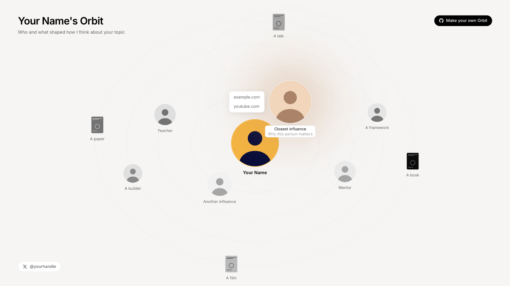

# Orbit

A single-page, no-build visual of the people, tools, and books that shaped a way of thinking. The owner sits in the center. Influences sit on thin dashed orbits around the owner, closest orbit first. Built as a backdrop for recording a talk or video, and readable on phones.



- Photos start in grayscale. Hover or focus brings back color, zooms the photo, and adds a diffused glow taken from the photo itself. On touch screens the first tap previews and a second tap opens the link. Items with several links open a small picker labeled by site (`youtube.com`, `x.com`).
- Portrait screens get an upright stage: orbits stretch vertically and names show only for the active item.
- Orbits turn very slowly. Motion pauses while one item is active, and neighbors step aside so nothing overlaps. A name that would cover another name or photo fades out until it has room again; inner rings win.
- Respects `prefers-reduced-motion`. Items are links with visible focus rings.
- Plain HTML, CSS, and JavaScript. No dependencies.

## Make your own

```bash
cp -R template data
```

Edit `data/people.json`, replace the images in `data/photos/`, then serve the folder (a browser blocks `fetch` on `file://`):

```bash
python3 -m http.server 5183
```

Open http://localhost:5183. The page loads `data/` first and falls back to `template/`. `data/` is git-ignored, so personal photos and notes stay out of the repo.

## `people.json`

| Field | Meaning |
|---|---|
| `name` | Name shown under the center photo. |
| `title` | Page title. `{name}` is replaced by `name`, e.g. `"{name}'s Orbit"`. |
| `subtitle` | Line under the title. |
| `photo` | Center photo, relative to the JSON file. |
| `chip` | Optional pill at bottom left: `{ "label": "@handle", "href": "https://x.com/handle" }`. Omit to hide. |
| `repo` | Optional call-to-action pill at top right: `{ "label": "Make your own Orbit", "href": "..." }`. Omit to hide. |
| `sourcesLink` | Optional pill at bottom right: `{ "label": "...", "href": "notes.md" }`, relative to the data folder. Use `null` to hide. |
| `ellipseRatio` | Orbit width divided by height. `1` gives circles. |
| `rotation.enabled` | Turn the slow rotation on or off. |
| `rings[]` | One entry per orbit, innermost first: `radiusY` (px on a 1600x900 stage), `size` (photo px), `phase` (start angle), `degPerSecond` (negative turns the other way), `shape` (`"cover"` for portrait book and poster covers). |
| `items[]` | `name`, `ring` (1 = innermost), `photo`, `tagline` (shown on hover), `links` (one opens directly; several open a site picker), `glow` (CSS color, or `null` for automatic), optional `shape` (`"circle"` or `"cover"`, overrides the ring's shape). |

Items on the same ring share an orbit and spread evenly. Group people by putting them on the same `ring`.

## Deploy

`build.sh` copies the app plus `data/` (or `template/`) into `dist/`. `wrangler.jsonc` serves `dist/` as Cloudflare Workers static assets. Set `name`, optionally add a custom domain (`"routes": [{ "pattern": "orbit.example.com", "custom_domain": true }]`), then:

```bash
./build.sh && npx wrangler deploy
```

Any static host works the same way: publish the contents of `dist/`.

## Style

Colors, type, and radii follow a warm paper palette (see `style.css` variables). Change the `:root` variables to retheme.
